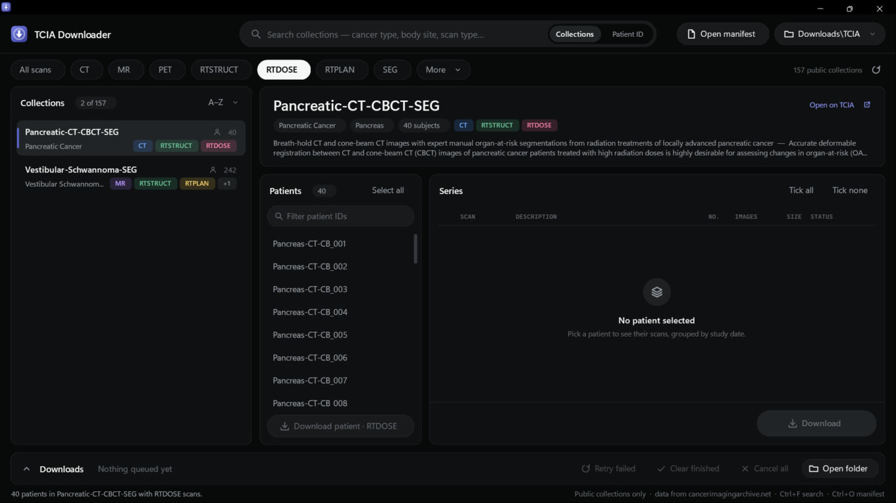

# TCIA Downloader

A Windows app for searching The Cancer Imaging Archive (TCIA) and downloading DICOM scans
straight to your computer, with no manifests and no NBIA Data Retriever.



**Run it:** double-click **TCIA Downloader** on the Desktop or in the Start menu
(the program itself is `dist\TCIA Downloader.exe`; nothing needs installing).

## How to use it

1. **Search.** Type in the search bar at the top to filter collections by cancer type (`breast`, `lung`),
   body site (`prostate`, `head`) or scan type (`CT`, `RTSTRUCT`). Press Enter to open the first match.
2. **Filter by scan type** with the chips underneath (*All scans, CT, MR, PET, RTSTRUCT, RTDOSE, RTPLAN, SEG, More*).
   The chip also limits the patient list and which series are pre-ticked.
3. **Pick a collection** on the left. Its details appear at the top, with a link to its TCIA page.
4. **Pick a patient.** Filter by part of an ID. Ctrl/Shift-click or *Select all* picks several,
   then **Download patients** gets all their scans.
5. **Tick the series** you want (grouped by study date; ticking a date ticks the whole study) and press
   the white **Download** button.
6. The **Downloads** card at the bottom opens automatically and shows progress, speed and time left.
   Double-click a row to open its folder, or right-click it for retry, cancel or copy UID. The arrow collapses the card.

Other ways in:

- **Patient ID search:** switch the search bar to *Patient ID*, type an exact ID (e.g. `LUNG1-001`) and press Enter
  to jump straight to that patient in any collection.
- **Open manifest:** opens a `.tcia` manifest you downloaded from the TCIA website (or drag one onto the window)
  and downloads everything in it.

Shortcuts: **Ctrl+F** search, **Ctrl+O** open manifest.

## Where files go

`Downloads\TCIA\<Collection>\<Patient>\<Study date + description>\<Series no. + modality + description>\1-001.dcm …`

Change the folder with the **Downloads\TCIA** button in the top-right. Each collection folder also gets its `LICENSE.txt`.
Series already on disk are marked **Saved** and skipped, so it's safe to queue the same patient again.

## Good to know

- Only **public** collections are listed (about 157). *Limited-access* collections such as HNSCC need a TCIA
  account and data-use agreement, so use the official Data Retriever for those.
- Two series download at a time. Failed ones are retried automatically, and **Retry failed** tries again later.
  The PC is kept awake while downloads run.
- The collection list is cached for a week in `%LOCALAPPDATA%\TCIA Downloader`. The refresh button (next to the chips) updates it sooner.
- The app follows the Windows light/dark app setting.

## Design and code

The look borrows from Linear (dark surfaces, thin borders, tag badges, compact rows) and Airbnb
(one big pill search bar, filter chips, a single bold call to action). Every control is drawn by the app
itself, so it looks the same on any Windows setup, including theme mods.

- `src\Core.cs`: TCIA API, downloading and unzipping, utilities, icon, self-test
- `src\Controls.cs`: theme, icons, cards, pill buttons, chips, text input, search bar, list
- `src\MainForm.cs`: the window, layout and browse/download logic

Rebuild with the C# compiler built into Windows (.NET Framework 4.8):

```powershell
powershell -ExecutionPolicy Bypass -File build.ps1
```

`"TCIA Downloader.exe" --selftest <folder>` runs a no-window check against the live TCIA API.

The previous (stock-controls) version is kept as `Program-v1-backup.cs.txt` for reference.
